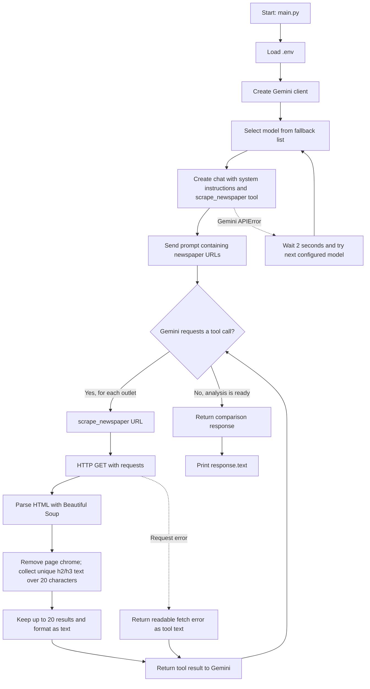

# Newspaper Headline Comparison

A small Python app that collects front-page headlines from Nigerian newspaper homepages and uses Google Gemini to compare their coverage, framing, and editorial tone.

## How it works

`main.py` registers `scrape_newspaper` as a Gemini tool. Gemini calls it for each newspaper URL in the prompt, and the scraper in `webscrapper_tool.py` fetches the page and extracts unique text from `<h2>` and `<h3>` elements. Up to 20 headlines per site are returned to Gemini for analysis.

The comparison is organized into:

- Shared top stories and differences in framing
- Unique angles or stories
- Overall editorial tone

The script tries the configured Gemini models in order and uses the first one that succeeds.

## Agent architecture

The agent is a tool-using Gemini chat wrapped by a small Python runner. `main.py` supplies the task and editorial instructions; Gemini decides when to call the registered `scrape_newspaper` tool for each URL. That tool delegates page retrieval and HTML parsing to `webscrapper_tool.py`, then returns a compact text list to Gemini. Gemini uses the collected tool results to write the comparison, which the runner prints to the terminal.

### Pipeline



### How the pieces connect

| Piece | Responsibility | Connects to |
| --- | --- | --- |
| `main.py` runner | Loads environment variables, creates the Gemini client and chat, sends the prompt, handles model fallback, and prints the final response. | Gemini SDK, `scrape_newspaper`, terminal |
| System instruction and prompt | Define the editor role, comparison sections, and the newspaper URLs to process. | Gemini chat |
| `scrape_newspaper(url)` tool | Calls the scraper, limits results to 20, and formats headlines as text for the model. | Gemini tool interface, `scrape_article_headlines` |
| `scrape_article_headlines(url)` | Makes the HTTP request and extracts unique headline text from static page HTML. Request failures are returned as readable text. | Newspaper website, `requests`, Beautiful Soup |
| Gemini model | Requests scraper calls, receives their results, compares coverage, and produces the final analysis. | Prompt, tool results, runner |

### Runtime sequence

1. `main.py` loads `.env`; `google-genai` reads `GEMINI_API_KEY` when `genai.Client()` is created.
2. For each configured model, the runner creates a chat with the system instruction and registers `scrape_newspaper` as an available function tool.
3. The runner sends the prompt. Gemini can invoke the tool once for each newspaper URL; the function calls `scrape_article_headlines` and returns up to 20 formatted headlines.
4. Gemini receives tool results in the chat and writes the requested comparison. The runner prints `response.text` and stops trying models.
5. If a Gemini API call raises `APIError`, the runner logs the failure, waits two seconds, and tries the next configured model. HTTP request errors are handled inside the scraper and returned to Gemini as text so the model can continue with other outlets.

## Requirements

- Python 3.10 or newer
- A Google Gemini API key

## Setup

Create and activate a virtual environment, then install the dependencies:

```bash
python -m venv .venv
source .venv/bin/activate
python -m pip install requests beautifulsoup4 google-genai python-dotenv
```

On Windows PowerShell, activate the environment with:

```powershell
.venv\Scripts\Activate.ps1
```

Create a `.env` file in the project directory and add your key:

```dotenv
GEMINI_API_KEY=your_gemini_api_key
```

`main.py` loads `.env` with `python-dotenv`, and the Google GenAI client reads `GEMINI_API_KEY` from the environment.

## Run

```bash
python main.py
```

The comparison is printed to the terminal. The newspaper URLs and prompt are currently defined in `main.py`; edit them there to compare different sites or change the requested analysis.

## Project files

- `main.py` — configures the Gemini client, tool, prompt, and model fallback order
- `webscrapper_tool.py` — fetches a page and extracts headlines from its HTML

## Notes and limitations

- Headline extraction is based on static HTML `<h2>` and `<h3>` tags. Sites that render content with JavaScript, use other elements, or block automated requests may return few headlines or none.
- The scraper skips navigation, header, footer, and aside elements and removes duplicate headlines. It returns a readable error string if a request fails.
- The analysis reflects the headlines available when the script runs; it does not verify story details or establish that a headline is an exclusive.
- Keep `.env` private and do not commit API keys.
# web_scrapping_agent
